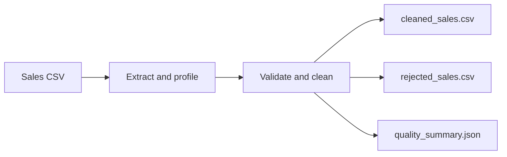

# Cloud-Based Sales Data ELT Pipeline

**Current status:** The local batch pipeline is implemented and locally tested.
GCS/BigQuery ingestion, warehouse SQL, dimensional modeling, and incremental
`MERGE` scripts are implemented but have **not** been run against a real GCP
project. Cloud permissions, SQL behavior, costs, and integration tests remain
unverified. No cloud credentials are needed for local execution.

## Business problem

Retail sales data often arrives as CSV exports that need validation and consistent
revenue calculation before analysts can trust it. This project establishes a
repeatable pipeline foundation and will progressively land source data in GCS,
transform it in BigQuery, and publish a dimensional model for analysis.

## Local architecture



## Technology

Python, Pandas, Google Cloud Storage and BigQuery Python clients, BigQuery
Standard SQL, pytest, Git, and GitHub Actions. The local implementation runs
without GCP credentials; cloud integration requires user-created resources and
ADC.

## Dataset and cleaning rules

The generator creates **synthetic** data (not real customer data) with order and
line identifiers, dates, customer/product attributes, quantity, price, discount,
and country. Required values and types are checked; invalid dates, missing
required values, nonnumeric values, quantities less than or equal to zero,
negative prices, and discounts outside 0–1 are quarantined with reasons. Missing
discount becomes 0; malformed non-empty discounts are rejected. Missing optional
descriptive attributes become `Unknown`.
Exact duplicates retain the first row. Conflicting records for one
`(order_id, order_line_id)` are all quarantined. The original CSV is untouched.
See [the data dictionary](docs/data_dictionary.md).

## Windows PowerShell: local setup

Run these commands from the repository root. Python 3.10+ is recommended.

```powershell
py -m venv .venv
.\.venv\Scripts\Activate.ps1
python -m pip install --upgrade pip
pip install -r requirements.txt
python -m src.generate_data --output data/raw/sales_synthetic.csv --rows 120 --seed 42
python -m src.run_pipeline --input data/raw/sales_synthetic.csv --output-dir data/processed
pytest
```

If PowerShell blocks activation, use this session-only setting and activate
again: `Set-ExecutionPolicy -Scope Process -ExecutionPolicy Bypass`.
Alternatively invoke `.venv\Scripts\python.exe` and
`.venv\Scripts\pytest.exe` directly without activation.

Expected artifacts: `data/processed/cleaned_sales.csv`,
`data/processed/rejected_sales.csv`, and `data/processed/quality_summary.json`.
The raw generated CSV remains unchanged. Output files are ignored by Git.

## Data quality and tests

`pytest` runs local unit and pipeline tests. These cover CSV extraction, required
columns, invalid dates/quantities/prices, null identifiers, duplicate handling,
revenue arithmetic, deterministic reruns, and raw-file preservation. No cloud
integration tests exist yet. The summary includes profile counts, accepted and
rejected rows, duplicate removals, rejection reasons, and accepted revenue.

## ELT and warehouse design

GCS is the immutable raw file landing zone; BigQuery stores raw string records,
typed staging/quarantine, and curated dimensional tables. The fact grain is one
sales line per `(order_id, order_line_id)`. Customer, product, and date dimensions
are implemented in SQL. Natural source IDs identify business entities while
warehouse surrogate keys identify dimension rows. See [the data model](docs/data_model.md)
and [architecture and status](docs/architecture.md).

## GCP setup, cloud execution, SQL, incremental loading

The code and SQL are present, but cloud execution remains unverified. Follow the
step-by-step [GCP setup and pricing guide](docs/troubleshooting.md), confirm
billing eligibility and current pricing before creating resources, and use ADC
with environment-based project, region, bucket, and dataset settings. The cloud
path keeps raw values as strings, uses BigQuery batch loads, quarantines invalid
rows in staging, builds the star schema, merges facts by a stable source-line
key, and updates an audit record. No service-account key files are stored.

## CI, cost, and security

CI installs dependencies, runs Ruff lint checks, and executes local tests without
cloud credentials. CD/deployment is not included. Raw data
and processed outputs are ignored, `.env` is ignored, and `.env.example` contains
placeholders only. Before cloud use, review storage lifecycle/cleanup, BigQuery
bytes scanned, IAM, and billing alerts. Delete any temporary cloud resources
after exercises to avoid charges.

## Limitations and next steps

The local mode processes one CSV at a time. Cloud file idempotency is keyed by
SHA-256 content and fact upserts use the order-line grain; late corrections use
Type 1 updates, not historical versions. Cloud unit behavior is tested with
fakes, but real cloud integration and SQL execution still need verification.
Scheduling, alerting, dbt, partitioning, and streaming are future extensions;
streaming is intentionally out of scope for the batch core.