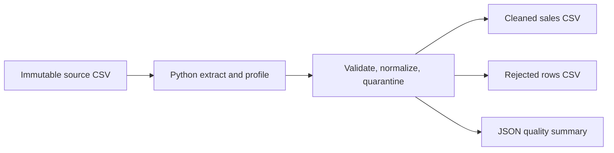
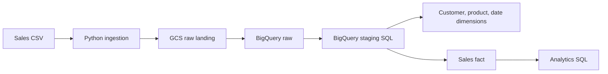

# Architecture and implementation status

## Implemented and locally tested: batch foundation

The local foundation is deliberately independent of cloud credentials. It
establishes source rules and repeatable outputs before cloud resources are added.

## Implemented in code/SQL; not cloud-tested

GCS upload, BigQuery raw batch load, audit records, staging/quarantine SQL,
dimensional `MERGE`s, fact upsert, and analytics/query assertions are implemented
in the source, SQL, and data-model docs. No GCP project was configured here:
permissions, region compatibility, SQL behavior, costs, and end-to-end integration
remain unverified. Orchestration and alerting remain future work.