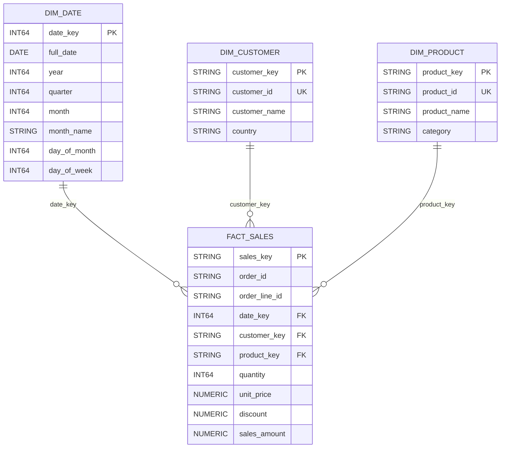

# Sales warehouse model

## Declared grain

`fact_sales` has one row per source order line: `(order_id, order_line_id)`. Its
stable warehouse merge key is `SHA256(TO_JSON_STRING(STRUCT(order_id,
order_line_id)))`. A source `order_id` can legitimately occur on multiple rows.
Conflicting records for the same pair are quarantined in staging rather than
arbitrarily selected.

## Star schema

BigQuery does not enforce primary/foreign key constraints; key uniqueness and
referential integrity are checked in `sql/data_quality_assertions.sql`.
`dim_customer` and `dim_product` use generated string surrogate keys while
retaining source natural IDs (`customer_id`, `product_id`) for matching. An
`UNKNOWN` member is provided for missing/unmatched references. `dim_date` uses
the integer `YYYYMMDD` natural date key. For this small source, country remains
a customer attribute rather than a separate dimension.

Dimensions are Type 1 in this first implementation: changed names/category are
updated in place. This deliberately does not retain history; SCD Type 2 should
be added only if business questions require historical attribute values.

## Interview explanation

“The fact table is at order-line grain so quantity and net line revenue are
additive. Customer, product, and date context is held in dimensions to make
common aggregations straightforward. Natural IDs from the source support
matching; warehouse keys decouple facts from source identifiers. Unknown members
and SQL assertions make missing lookups visible without dropping sales.”